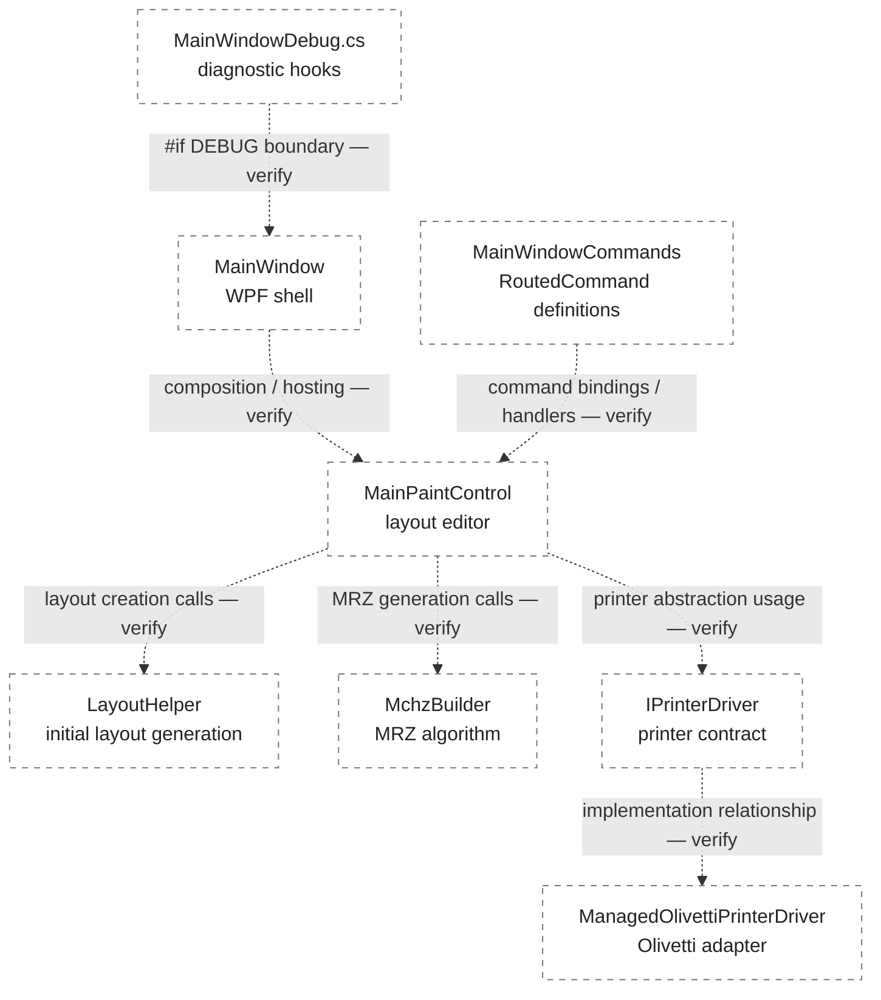

# UMMS — архитектурный обзор кодовой базы

> **Статус: Draft / Черновик.** Source-based analysis. Этот документ фиксирует предварительную карту компонентов по имеющемуся описанию исходников. Он не является спецификацией поведения и не подтверждает архитектурные связи, пока они не проверены по полным исходникам и, где требуется, в работающем приложении.

| Параметр | Значение |
|---|---|
| Система | UMMS — WPF-приложение «Стационарная станция» |
| Раздел | Архитектура / обзор кодовой базы |
| Основной файл | `docs/architecture/codebase-overview.md` |
| Тип анализа | Source-based analysis |
| Статус | Draft |

## 1. Назначение и границы анализа

Раздел описывает предполагаемое распределение ответственности между UI-компонентами, командами, редактором макета, алгоритмом формирования машинночитаемой зоны (МЧЗ) и слоем взаимодействия с принтером.

Обзор ограничен перечисленными файлами и сведениями, доступными на момент подготовки документа. Полная кодовая база, XAML-разметка, реализация драйвера и поведение работающего приложения пока не проверены в рамках этого обзора.

**Важно:** пунктирные связи на диаграмме — гипотезы для проверки, а не подтверждённые зависимости. Даже если названия компонентов предполагают такую связь, она должна быть установлена по вызовам, привязкам команд, интерфейсам или runtime-поведению.

В область этого документа не входят:
- пользовательская последовательность печати документов;
- полная спецификация форматов макетов и XML;
- полная спецификация МЧЗ;
- описание внутреннего устройства драйвера Olivetti, пока его исходники не изучены.

Пользовательский сценарий печати описывается отдельно в [«Печать документов»](../user-guide/printing-documents.md).

## 2. Компонентная карта

Все показанные зависимости являются **предполагаемыми и требуют проверки**. Пунктирная линия намеренно используется для каждой связи.

Диаграмма показывает предполагаемую структуру для дальнейшего ревью. Она не доказывает, что:
- команды действительно привязаны к обработчикам именно в `MainPaintControl`;
- редактор вызывает оба вспомогательных компонента;
- указанный класс является реализацией интерфейса `IPrinterDriver`;
- отладочные хуки недоступны в Release-сборке.

Эти положения остаются открытыми до проверки исходников.

## 3. Компоненты

### 3.1. MainWindow / MainPaintControl — UI

**Предварительное назначение по имеющемуся описанию:**
- `MainWindow.xaml.cs` выполняет инициализацию главного окна и выводит номер версии приложения;
- `MainPaintControl.xaml.cs` содержит основной редактор макета: область страниц, панель свойств, операции над строками и рамками, загрузку и сохранение XML-макета, а также подготовку макета к печати.

Указанные обязанности следует сверить с XAML и полными файлами code-behind. В частности, необходимо установить, какие элементы принадлежат самому `MainWindow`, а какие — `MainPaintControl`.

### 3.2. MainWindowCommands — RoutedCommand

`MainWindowCommands.cs`, согласно предварительному описанию, объявляет команды приложения и сочетания клавиш, включая создание, сохранение и печать.

Наличие объявления команды само по себе не подтверждает её привязку к конкретному обработчику. Для установления связи необходимо проверить:
- объявления `RoutedCommand`;
- `CommandBindings` и `InputBindings` в XAML и code-behind;
- методы-обработчики и условия `CanExecute`;
- фактическую доступность сочетаний клавиш в приложении.

### 3.3. LayoutHelper — формирование макета

`LayoutHelper.cs`, по имеющемуся описанию, формирует исходное расположение элементов на страницах на основе данных персоны и документа. Предварительно указано следующее распределение:
- страница 2 — орган выдачи, дата и код;
- страница 3 — фамилия, имя, отчество и сведения о рождении;
- страницы 4–19 — пустые.

Это описание пока не подтверждено выполнением приложения. Требуется проверить вызовы `LayoutHelper`, структуру создаваемых моделей страниц и фактическое содержимое страниц при открытии макета.

### 3.4. MchzBuilder — отдельный алгоритмический модуль

`MchzBuilder.cs` предварительно выделяется как компонент формирования машинночитаемой зоны (МЧЗ). В описании исходников упоминаются две строки по 44 символа, таблица транслитерации русских букв и контрольная сумма с весами 7–3–1.

До проверки реализации нельзя считать подтверждёнными:
- применяемый тип документа и соответствующий формат МЧЗ;
- полноту и точность таблицы транслитерации;
- позиции контрольных цифр и правила расчёта;
- обработку пустых, недопустимых и граничных значений.

Соответствие ICAO Doc 9303 должно подтверждаться тестовыми векторами и сверкой с применимыми требованиями стандарта, а не только наличием весов 7–3–1 в коде.

### 3.5. IPrinterDriver / Olivetti — граница взаимодействия

Предполагается, что `IPrinterDriver` задаёт контракт взаимодействия с печатающим устройством, а `ManagedOlivettiPrinterDriver` реализует этот контракт для оборудования Olivetti.

Эта связь не подтверждена. Для её проверки нужны:
- полный исходник `IPrinterDriver.cs`;
- определения перечислений `Quality`, `Cpi` и `Doctype`;
- полный исходник `ManagedOlivettiPrinterDriver`;
- места создания и передачи экземпляра драйвера;
- описание или доступная реализация нижележащей обёртки над драйвером Olivetti.

До этого момента нельзя утверждать, что бизнес-логика полностью изолирована от конкретного драйвера.

### 3.6. MainWindowDebug — диагностический механизм

`MainWindowDebug.cs`, по предварительному описанию, содержит отладочные действия в условной компиляции `#if DEBUG`; сочетания Ctrl+Alt+F1…F11 используются для диагностических операций с принтером.

Необходимо проверить область действия директивы `#if DEBUG`, регистрацию команд и конфигурацию сборки Release. Само наличие директивы в файле не доказывает, что все отладочные команды и связанные обработчики исключены из Release-сборки.

## 4. Таблица проверяемых утверждений

Все статусы в таблице на момент подготовки документа — **не проверено**.

| Утверждение | Подтверждающий исходник | Способ проверки | Статус |
|:---|:---|:---|:---:|
| `MainWindowCommands` привязаны к обработчикам `MainPaintControl` | `MainWindowCommands.cs`, XAML командных привязок | Ревью `CommandBindings`, `InputBindings` и методов-обработчиков | ☐ |
| `MainPaintControl` вызывает `LayoutHelper` при формировании макета | `MainPaintControl.xaml.cs`, `LayoutHelper.cs` | Поиск прямых/косвенных вызовов; тест сценария создания макета | ☐ |
| `MainPaintControl` вызывает `MchzBuilder` при генерации МЧЗ | `MainPaintControl.xaml.cs`, `MchzBuilder.cs` | Поиск вызовов; модульные тесты алгоритма и тест интеграции | ☐ |
| `ManagedOlivettiPrinterDriver` реализует `IPrinterDriver` | `PassportPaintDriver/IPrinterDriver.cs`, исходник реализации | Ревью объявления интерфейса, класса и мест внедрения/создания | ☐ |
| `MainWindowDebug` ограничен `#if DEBUG` и диагностические команды недоступны в Release | `MainWindowDebug.cs`, проектные файлы сборки | Проверка условной компиляции и сборка Release; проверка отсутствия команд в доступном UI | ☐ |
| Реализация МЧЗ соответствует применимым требованиям ICAO Doc 9303 | `MchzBuilder.cs`, тестовые векторы | Проверка формата, транслитерации, позиций и контрольных сумм на эталонных примерах | ☐ |
| DPI-пересчёт и преобразование координат корректны | `MainPaintControl` (предположительно `PrintOnExecuted`), связанные типы | Ревью преобразований; тестирование на разных DPI и на реальном принтере | ☐ |
| Страницы 4–19 действительно остаются пустыми | `LayoutHelper.cs`, модели страниц и провайдеры макета | Анализ создаваемых объектов; запуск приложения и визуальная проверка результата | ☐ |

### 4.1. Критерии закрытия проверок

- **Исходник найден и прочитан** — подтверждает только наличие конкретной реализации или вызова в изученном файле.
- **Связь подтверждена** — дополнительно проверены обе стороны взаимодействия: вызов и обработчик, интерфейс и реализация, условие компиляции и конфигурация сборки.
- **Поведение проверено** — выполнен воспроизводимый сценарий в работающем приложении или тесте; указаны условия и результат.
- **Соответствие стандарту подтверждено** — алгоритм проверен на применимых эталонных примерах. Одного code review недостаточно.

Непроверенные пункты остаются открытыми. Отсутствие найденного вызова в одном файле не доказывает отсутствия связи во всей системе.

## 5. Что необходимо для перехода Draft → Final

### 5.1. Исходники PassportPaintDriver

- `IPrinterDriver.cs`;
- перечисления `Quality`, `Cpi`, `Doctype`;
- полная реализация `ManagedOlivettiPrinterDriver`.

### 5.2. XAML-файлы

- `MainWindow.xaml`;
- `MainPaintControl.xaml`;
- `SelectNewLayout.xaml`.

### 5.3. Модели и провайдеры

- `LineBaseModel`;
- `PassportPage`;
- `DefaultLayoutProvider`;
- `UserLayoutProvider`.

### 5.4. Поведенческая проверка

Нужно доступное для запуска приложение и воспроизводимые сценарии проверки:
- привязок команд и горячих клавиш;
- создания и редактирования макета;
- генерации МЧЗ;
- поведения отладочных команд в Debug и Release;
- DPI-пересчёта и отправки на реальный принтер;
- фактического содержимого страниц 4–19.

Получение исходников само по себе не переводит документ в Final. Для каждого утверждения должны быть зафиксированы доказательство и результат соответствующей проверки.

## 6. Редакционное примечание

Раздел относится только к системе UMMS — WPF-приложению «Стационарная станция». Он ведётся отдельно от документации Global11 / Oracle Data Modeler и не должен включать материалы о GEO_ROLLUP, Oracle Data Modeler или других системах.

Статус Draft отражает незавершённость ревью исходников и интерфейса UMMS. Это отдельное основание для проверки и не связано со статусом материалов Global11.
